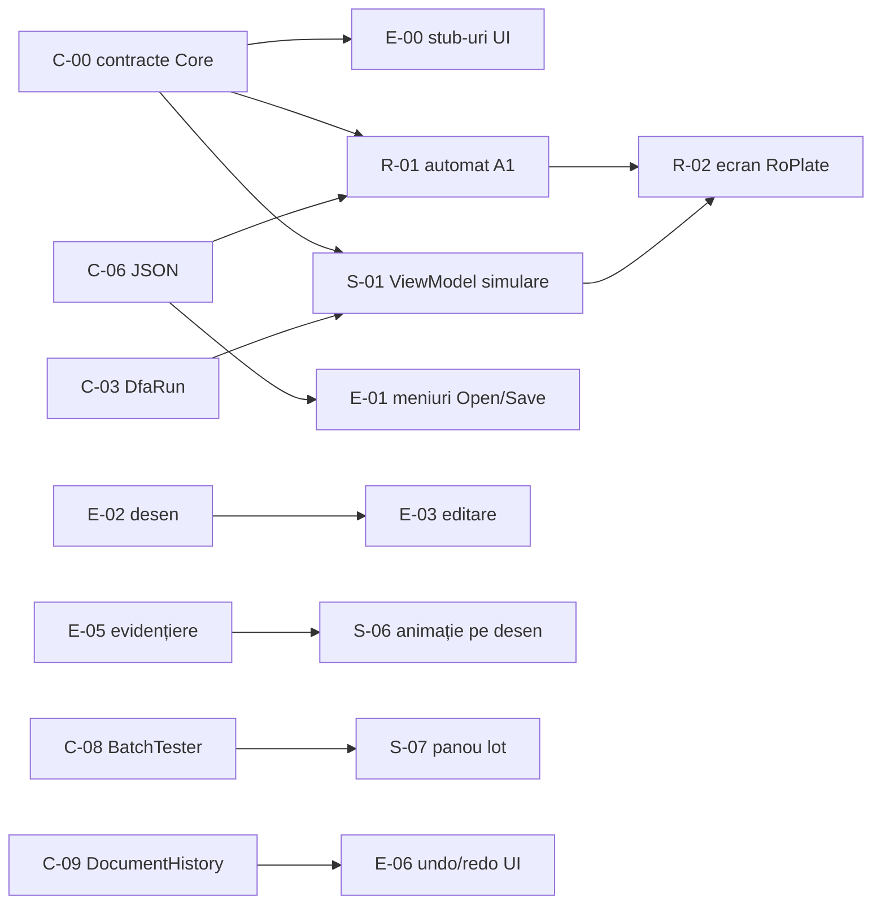

# Planul echipei: RoPlate / Simulator AFD

Echipă de 3 persoane, 5 săptămâni. Scopul acestui plan: **fiecare poate lucra în paralel, fără să-l aștepte pe celălalt**, pentru că punctele de contact dintre părți (**contractele**) sunt stabilite de la început.

> Înainte de cod, citiți teoria: [../teorie/README.md](../teorie/README.md).

---

## 1. Rolurile

| Persoană | Rol | Ce deține | Sarcini |
|---|---|---|---|
| **P1** | Motorul (Core) | `Dfa.Core` + testele lui + tabelul δ din interfață | [sarcini-P1-core.md](sarcini-P1-core.md) |
| **P2** | Editorul și fereastra principală | fereastra, meniurile, desenul automatului (`DfaCanvas`), editarea | [sarcini-P2-editor.md](sarcini-P2-editor.md) |
| **P3** | Simularea și RoPlate | panoul de simulare, banda, tabelul de execuție, testarea în lot, automatul A1, ecranul RoPlate | [sarcini-P3-simulare-roplate.md](sarcini-P3-simulare-roplate.md) |

Înlocuiți P1/P2/P3 cu numele voastre. Specificația spune „1–2 studenți”; verificați cu profesorul că 3 este în regulă.

---

## 2. Contractele

Un **contract** = ce oferă o parte celorlalte: numele claselor, metodele, ce returnează, ce mesaje afișează, formatul fișierelor. Cât timp contractul nu se schimbă, fiecare își poate modifica liber implementarea.

| Contract | Fișier | Cine îl implementează | Cine îl folosește |
|---|---|---|---|
| API-ul motorului | [contracte/01-core-api.md](contracte/01-core-api.md) | P1 | P2, P3 |
| Formatul `.dfa.json` | [contracte/02-format-json.md](contracte/02-format-json.md) | P1 (citire/scriere) | toți (P3 scrie automatul A1 de mână) |
| Interfața grafică (sesiune, canvas, panouri, navigare) | [contracte/03-app-ui.md](contracte/03-app-ui.md) | P2 (sesiune, canvas, fereastră), P3 (panouri) | toți |

### Regula de aur

1. **Ziua 1–2:** P1 creează soluția și pune în `Dfa.Core` **toate clasele publice din contract, cu metodele goale** (`throw new NotImplementedException()`). P2 creează la fel stub-urile din contractul UI. Codul compilează, deci toți pot începe.
2. Contractul se **modifică doar printr-un PR** care schimbă și fișierul `.md` din `docs/plan/contracte/`, aprobat de **ceilalți doi**.
3. Până când o parte e gata, cine o folosește lucrează cu **date false** (de ex. un automat construit direct în cod).

---

## 3. Cine ce foldere deține

Fiecare fișier are un singur „proprietar”. Ceilalți îl pot citi, dar îl modifică doar prin PR aprobat de proprietar. Așa evitați conflictele de merge.

```
DfaSimulator.slnx                                    P1
src/
├─ Dfa.Core/                                         P1
│  └─ Examples/
│     ├─ par-a.dfa.json … lungime-3.dfa.json         P1
│     └─ nr-inmatriculare.dfa.json                   P3
└─ Dfa.App/
   ├─ App.axaml, MainWindow.axaml                    P2
   ├─ Services/ (DocumentSession, Navigation)        P2
   ├─ Themes/Styles.axaml (culori comune)            P2
   ├─ Controls/DfaCanvas/                            P2
   ├─ Views/Editor/                                  P2
   ├─ Views/TransitionTable/                         P1
   ├─ Controls/InputTape/                            P3
   ├─ Views/Simulator/                               P3
   └─ RealApps/RoPlate/                              P3
tests/Dfa.Tests/
├─ Core/                                             P1
└─ RealApps/                                         P3
docs/plan/contracte/                                 toți (PR cu 2 aprobări)
```

> Diferență față de specificație: exemplele `.dfa.json` stau în **Dfa.Core** (ca resurse încorporate), nu în Dfa.App. Așa le pot încărca și testele, fără interfață.

---

## 4. Calendarul

| Săpt. | P1: Core | P2: Editor | P3: Simulare + RoPlate | Punct de integrare (toți) |
|---|---|---|---|---|
| **1** | C-00 contracte, C-01…C-04 (model, clase de simboluri, rulare, validator) | E-00 stub-uri UI, E-01 fereastra, meniuri | R-01 automatul A1 scris de mână în JSON + testele lui; S-01 ViewModel simulare (pe un `Dfa` construit în cod) | **M1:** contractele intră în `main`; testele motorului pe exemplele 1–6 sunt verzi |
| **2** | C-05…C-07 (document, JSON, exemple) | E-02 desenarea automatului, E-05 evidențiere | S-02 banda, S-03 tabel execuție, S-04 verdict | **M2:** se deschide un exemplu din meniu și apare desenat |
| **3** | C-08 testare în lot, C-09 undo/redo, C-10 capcană | E-03 editarea pe desen, E-04 alfabet și clase | S-05 Play, S-06 evidențierea pe desen | **M3:** simulare completă pe exemplele 1–3, cu animație pe desen |
| **4** | C-11 tabelul δ, C-12 acoperire teste ≥ 70% | E-06 undo/redo + capcană în UI, E-07 descrieri stări | S-07 panou testare în lot, S-08 modul „Ghicește”, R-01 automatul A1 aranjat în editor | **M4:** automatul A1 trece toate cuvintele de test în aplicație |
| **5** | C-13 (bonus generator), raport | E-08 (bonus export PNG/SVG), finisare | R-02 ecranul RoPlate, R-03 (bonus coduri reale de județ) | **M5:** prezentarea finală, README, raport |

Detaliile fiecărei sarcini (ce face, de ce depinde, când e „gata”) sunt în fișierele de sarcini.

### Dependențele importante



Singurele blocaje reale sunt **C-00** (primele 1–2 zile, toți îl așteaptă) și **E-05** (P3 are nevoie de evidențierea pe desen în săptămâna 3). Până atunci P3 testează simularea fără desen (banda + tabelul de execuție).

---

## 5. Cum lucrați cu Git

- `main` conține mereu cod care **compilează și trece testele**.
- Fiecare sarcină = o ramură: `p1/c-03-dfarun`, `p2/e-02-canvas`, `p3/s-02-banda`.
- PR-uri mici (o sarcină), revizuite de **cel puțin o altă persoană**.
- Înainte de PR: `dotnet build` și `dotnet test` fără erori.
- Mesajele din interfață sunt **în română**; numele claselor și metodelor sunt în engleză (ca în specificație).
- Fiecare commit are autorul corect: README-ul final trebuie să arate contribuția fiecăruia.

## 6. Ce este „gata” (pentru orice sarcină)

- [ ] Codul compilează și testele trec.
- [ ] Respectă contractul (nume, semnături, mesaje).
- [ ] Are teste, dacă e cod în `Dfa.Core`.
- [ ] Nu blochează aplicația la date greșite (afișează mesaj).
- [ ] A fost revizuit și intrat în `main`.
