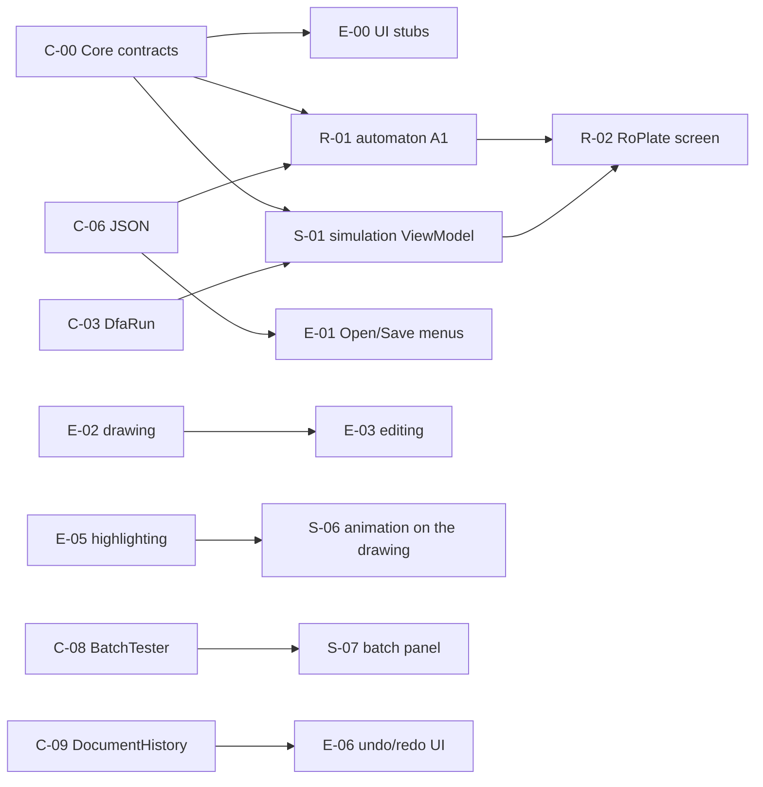

# Team plan: RoPlate / DFA Simulator

A team of 3. The goal of this plan: **everyone can work in parallel without waiting for the others**, because the points of contact between the parts (the **contracts**) are fixed from the start.

---

## 1. Roles

| Person | Role | Owns | Tasks |
|---|---|---|---|
| **P1** | The engine (Core) | `Dfa.Core` + its tests + the δ table in the UI | [tasks-P1-core.md](tasks-P1-core.md) |
| **P2** | The editor and the main window | the window, the menus, the automaton drawing (`DfaCanvas`), editing | [tasks-P2-editor.md](tasks-P2-editor.md) |
| **P3** | Simulation and RoPlate | the simulation panel, the tape, the execution table, batch testing, automaton A1, the RoPlate screen | [tasks-P3-simulation-roplate.md](tasks-P3-simulation-roplate.md) |

Replace P1/P2/P3 with your names. The specification says "1–2 students"; check with the teacher that 3 is fine.

---

## 2. The contracts

A **contract** = what one part offers the others: class names, methods, what they return, what messages they show, the file format. As long as the contract does not change, everyone can freely change their implementation.

| Contract | File | Implemented by | Used by |
|---|---|---|---|
| Engine API | [contracts/01-core-api.md](contracts/01-core-api.md) | P1 | P2, P3 |
| The `.dfa.json` format | [contracts/02-json-format.md](contracts/02-json-format.md) | P1 (reading/writing) | everyone (P3 writes automaton A1 by hand) |
| The UI (session, canvas, panels, navigation) | [contracts/03-app-ui.md](contracts/03-app-ui.md) | P2 (session, canvas, window), P3 (panels) | everyone |

### The golden rule

1. **Days 1–2:** P1 creates the solution and puts **all the public classes from the contract, with empty methods** (`throw new NotImplementedException()`), in `Dfa.Core`. P2 does the same for the UI contract stubs. The code compiles, so everyone can start.
2. A contract **changes only through a PR** that also changes the `.md` file in `docs/plan/contracts/`, approved by **the other two**.
3. Until a part is ready, whoever uses it works with **fake data** (e.g. an automaton built directly in code).

---

## 3. Who owns which folders

Each file has a single "owner". The others can read it, but change it only through a PR approved by the owner. This avoids merge conflicts.

```
DfaSimulator.slnx                                    P1
src/
├─ Dfa.Core/                                         P1
│  └─ Examples/
│     ├─ even-a.dfa.json … length-3.dfa.json         P1
│     └─ license-plate.dfa.json                      P3
└─ Dfa.App/
   ├─ App.axaml, MainWindow.axaml                    P2
   ├─ Services/ (DocumentSession, Navigation)        P2
   ├─ Themes/Styles.axaml (shared colors)            P2
   ├─ Controls/DfaCanvas/                            P2
   ├─ Views/Editor/                                  P2
   ├─ Views/TransitionTable/                         P1
   ├─ Controls/InputTape/                            P3
   ├─ Views/Simulator/                               P3
   └─ RealApps/RoPlate/                              P3
tests/Dfa.Tests/
├─ Core/                                             P1
└─ RealApps/                                         P3
docs/plan/contracts/                                 everyone (PR with 2 approvals)
```

> Difference from the specification: the `.dfa.json` examples live in **Dfa.Core** (as embedded resources), not in Dfa.App. That way the tests can load them too, without the UI.

---

## 4. Schedule

| Week | P1: Core | P2: Editor | P3: Simulation + RoPlate | Integration point (everyone) |
|---|---|---|---|---|
| **1** | C-00 contracts, C-01…C-04 (model, symbol classes, run, validator) | E-00 UI stubs, E-01 window, menus | R-01 automaton A1 written by hand in JSON + its tests; S-01 simulation ViewModel (on a `Dfa` built in code) | **M1:** the contracts are in `main`; the engine tests on examples 1–6 are green |
| **2** | C-05…C-07 (document, JSON, examples) | E-02 drawing the automaton, E-05 highlighting | S-02 tape, S-03 execution table, S-04 verdict | **M2:** an example opens from the menu and appears drawn |
| **3** | C-08 batch testing, C-09 undo/redo, C-10 trap state | E-03 editing on the drawing, E-04 alphabet and classes | S-05 Play, S-06 highlighting on the drawing | **M3:** full simulation on examples 1–3, animated on the drawing |
| **4** | C-11 the δ table, C-12 test coverage ≥ 70% | E-06 undo/redo + trap state in the UI, E-07 state descriptions | S-07 batch testing panel, S-08 "Guess" mode, R-01 automaton A1 laid out in the editor | **M4:** automaton A1 passes all test words in the app |
| **5** | C-13 (bonus generator), report | E-08 (bonus PNG/SVG export), polish | R-02 the RoPlate screen, R-03 (bonus real county codes) | **M5:** final presentation, README, report |

The details of each task (what it does, what it depends on, when it is "done") are in the task files.

### Key dependencies



The only real blockers are **C-00** (the first 1–2 days, everyone waits for it) and **E-05** (P3 needs highlighting on the drawing in week 3). Until then P3 tests the simulation without the drawing (the tape + the execution table).

---

## 5. How to work with Git

- `main` always holds code that **compiles and passes the tests**.
- Each task = one branch: `p1/c-03-dfarun`, `p2/e-02-canvas`, `p3/s-02-tape`.
- Small PRs (one task), reviewed by **at least one other person**.
- Before a PR: `dotnet build` and `dotnet test` with no errors.
- UI text, messages, docs and identifiers are **in English**.
- Every commit has the correct author: the final README must show each person's contribution.

## 6. What "done" means (for any task)

- [ ] The code compiles and the tests pass.
- [ ] It follows the contract (names, signatures, messages).
- [ ] It has tests, if it is code in `Dfa.Core`.
- [ ] It does not freeze the app on bad data (it shows a message).
- [ ] It was reviewed and merged into `main`.
